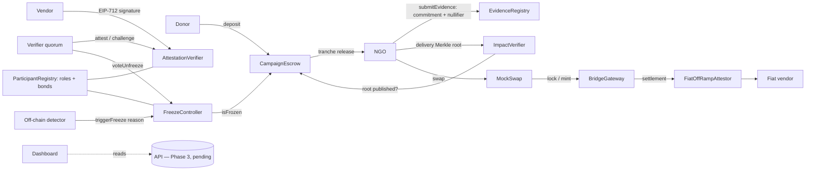

# The Black Hole Ledger

Verifiable NGO donation accountability — CASCADE '26, Theme 4, Problem 2.

## Problem

Donations disappear into a "black hole": once money reaches an NGO, donors cannot see whether it was spent as promised, receipts can be reused or forged, and audits depend on a single trusted auditor. The Black Hole Ledger keeps donations in purpose-bound escrow, releases them in tranches only when evidence passes independent verification, hides beneficiary identities behind Merkle commitments, and freezes a campaign when fraud signals appear.

## Architecture



## Contract responsibilities

| Contract | Responsibility |
|---|---|
| `ParticipantRegistry` | Roles (NGO, vendor, verifier, donor), vendor signing keys; verifier admission (bootstrap, then a 2-verifier vote), minimum bond, slashing |
| `CampaignEscrow` | Campaign creation, deposits up to target, ordered tranche release, refunds when frozen or expired |
| `EvidenceRegistry` | Evidence commitments, global nullifier registry (rejects reuse), commit-reveal of salt |
| `AttestationVerifier` | Vendor EIP-712 attestations, verifier quorum attest / challenge, challenge resolution |
| `FreezeController` | Freeze state and reason codes (1 duplicate nullifier, 2 forged ratio, 3 category breach, 4 upheld challenge); both freeze and unfreeze need a verifier quorum, counted per freeze episode |
| `ImpactVerifier` | Delivery Merkle root per campaign, `verifyDelivery(campaignId, leaf, proof)` |
| `mocks/*` | `MockUSD`, `MockSwap`, `BridgeGateway` (lock/mint), `FiatOffRampAttestor` — clearly labelled test doubles |

## Evidence formulas

```
commitment = keccak256(salt || invoiceHash || vendorId || amount || category || date)
nullifier  = keccak256(invoiceHash || vendorId || amount || date)      // global, salt-independent
leaf       = keccak256(beneficiarySecret || deliveryRecord)             // delivery commitment
tree       = keccak256(0x00 || leaf) for leaves, keccak256(0x01 || min(a,b) || max(a,b)) for nodes
settlement = EIP-191 signature by a registered off-ramp partner over keccak256(attestor, chainId, hopId, amount, asset)
```

## Evaluation-chain scoring formula

Each donation gets four stage scores in [0, 1] and a composite. Every score lists its contributing factors (no black boxes).

| Stage | Factors (weight) |
|---|---|
| S1 Inbound donation | deposit confirmed and within target cap (1.0) |
| S2 Escrow condition | campaign active and not frozen (0.6), tranche conditions defined (0.2), release conditions verifiable on-chain (0.2) |
| S3 Off-chain invoice proof | commitment submitted (0.3), nullifier unique (0.3), vendor attestation valid (0.2), verifier quorum reached (0.2) |
| S4 Cryptographic impact verification | delivery root published (0.5), leaf inclusion verifiable (0.3), per-tranche impact score > 0.5 (0.2) |

```
Composite = 0.25·S1 + 0.25·S2 + 0.25·S3 + 0.25·S4      (weights configurable)
```

Risk flags are separate from confidence: unexplained transfer, category breach, report-vs-ledger mismatch, duplicate evidence, and a statistical `forgeryLikelihood` in [0, 1] from vendor concentration, amount clustering and timestamp anomalies. Full derivation: [docs/PHASE0-formulas.md](docs/PHASE0-formulas.md).

## Evidence Trust Model

**What cryptography guarantees**
- *Integrity* — a committed receipt cannot be altered afterwards.
- *Non-reuse* — the global nullifier stops the same invoice being claimed twice, across every campaign and donor.
- *Ordering* — tranches release strictly in order, and only after evidence and a delivery root exist.
- *Binding* — each commitment binds spend to vendor, amount, category and date; vendor attestations are EIP-712 signatures from a registered key.

**What it cannot guarantee**
- That the real-world receipt is genuine, or that goods were actually delivered (the oracle problem).

**How the gap is closed without a central auditor**
- Vendor-signed attestations tie each receipt to an accountable, registered vendor key.
- A staked verifier quorum attests or challenges each receipt; a verifier caught attesting forged evidence is slashed.
- Statistical anomaly signals (vendor concentration, amount clustering, timing) flag patterns for review.
- Cross-campaign nullifier uniqueness blocks receipt recycling.
- Freezes halt disbursement and open a refund path; only a verifier quorum can unfreeze.

**Residual risks**
- *Vendor–NGO collusion* — a real vendor can sign a fake invoice. Mitigations: vendor concentration signals, delivery Merkle proofs that beneficiaries can check, verifier spot checks.
- *Verifier collusion* — a majority of verifiers could approve forged evidence. Mitigations: bonds and slashing, a larger and more diverse quorum, and any single verifier can raise a public challenge.

Beneficiary privacy is **commitment-based selective disclosure with Merkle proofs — not zero-knowledge**. A ZK upgrade (proving inclusion without revealing the leaf) is a documented future path, not implemented.

## Setup and commands

**Deployment wiring.** Contracts are linked once, and the links cannot be changed later. Required order:

1. Deploy `ParticipantRegistry` → `FreezeController(registry)` → `ImpactVerifier` → `CampaignEscrow(token, freeze, impact)` → `EvidenceRegistry` → `AttestationVerifier(registry, quorum ≥ 2, challenges)`.
2. Wire them:
   - `impact.setEscrow(escrow)`
   - `evidence.setEscrow(escrow)`
   - `attest.setEvidenceRegistry(evidence)`
   - `escrow.setAttestationVerifier(attest)`
3. Admit the initial verifiers with `registry.admitVerifier(v)`, then call `registry.closeBootstrap()`.

`scripts/redteam.ts` and `test/integration/fixture.ts` do exactly this.

### Running the project

Requires Node 18+ (tested on Node 24). Run every command from the project root.

**1. Install dependencies (once)**

```bash
npm install
```

```bash
npm --prefix dashboard install
```

**2. Start the local blockchain** (leave this terminal open)

```bash
npx hardhat node
```

This starts a local Ethereum node at `http://127.0.0.1:8545` (chain ID 31337) with 20 funded test accounts. If it fails with `EADDRINUSE`, another node is already listening on port 8545; skip this step and use that one.

**3. Deploy and run the full scenario on that chain** (second terminal)

```bash
npm run demo:redteam:localhost
```

This deploys and wires every contract, then runs the full scenario:

- a donation;
- the honest tranche through swap → bridge → off-ramp;
- the reused-receipt and forged-receipt attacks;
- the freezes, the slashing and the refund.

It prints the results and writes [reports/redteam-report.md](reports/redteam-report.md). It is currently the only script that deploys the contracts.

**4. Start the dashboard** (third terminal)

```bash
npm run dev
```

Open http://localhost:5173. The dashboard is not connected to the chain yet: the Phase 3 API that would link them does not exist, so it shows clearly labelled demo data.

**Without starting a blockchain**

Run the same scenario on Hardhat's built-in, temporary network:

```bash
npm run demo:redteam
```

Run all tests:

```bash
npm test
```

Generate the coverage report:

```bash
npm run coverage
```

### Command reference

| Command | What it does | Status |
|---|---|---|
| `npm run setup` / `npm install` | Install root dependencies (`npm --prefix dashboard install` for the UI) | works |
| `npx hardhat node` | Local blockchain on http://127.0.0.1:8545 (chain 31337) | works |
| `npm test` | 96 tests: 47 unit, 15 integration, 33 security probes, 1 smoke test (see [reports/test-report.md](reports/test-report.md)) | works, all passing; 97.5% line coverage |
| `npm run demo:redteam` | Adversarial scenario on an in-process Hardhat network; writes [reports/redteam-report.md](reports/redteam-report.md) | works |
| `npm run demo:redteam:localhost` | Same scenario against `npx hardhat node` | works with a running node |
| `npm run dev` | Dashboard (Vite) on http://localhost:5173 | works — runs on labelled demo data until an API is connected via `VITE_API_URL` |
| `npm run coverage` | Solidity coverage | works — 97.5% lines, 86.4% branches |
| `npm run lint` | ESLint + Solhint | **broken** — ESLint is not installed/configured and there is no `.solhint.json`; Solhint with recommended rules reports 0 errors, 89 style warnings |
| `npm run chain:up`, `deploy:local`, `services:up` | Two-node chain, deploy+seed, off-chain services | **not implemented** — `scripts/deploy-local.ts`, `seed.ts`, `relayer.ts` and `services/*` were not produced in Phases 2–3 |

## Repository

```
contracts/   core, interfaces, libraries, mocks
test/        unit (47), integration (15), security probes (33)
scripts/     redteam.ts
dashboard/   Vite + React + TypeScript UI (see dashboard/SOURCES.md)
reports/     redteam-report.md
docs/        Phase 0 design documents
```

See [SECURITY.md](SECURITY.md) for the threat model and known gaps.
