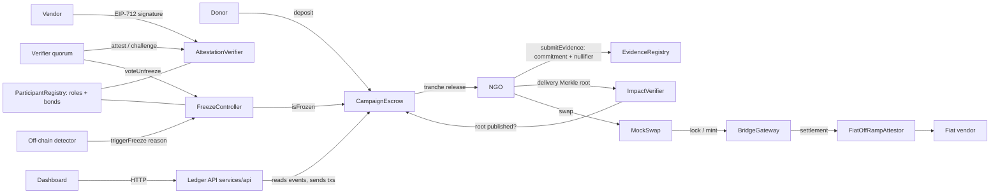

# The Black Hole Ledger

Verifiable NGO donation accountability — CASCADE '26, Theme 4, Problem 2.

## Problem

Donations disappear into a "black hole": once money reaches an NGO, donors cannot see whether it was spent as promised, receipts can be reused or forged, and audits depend on a single trusted auditor. The Black Hole Ledger keeps donations in purpose-bound escrow, releases them in tranches only when evidence passes independent verification, hides beneficiary identities behind Merkle commitments, and freezes a campaign when fraud signals appear.

## Architecture



## Contract responsibilities

| Contract | Responsibility |
|---|---|
| `ParticipantRegistry` | Roles (NGO, vendor, verifier, donor), vendor signing keys; verifier admission (bootstrap, then a 2-verifier vote), minimum bond, slashing |
| `CampaignEscrow` | Campaign creation, deposits up to target, ordered tranche release, refunds when frozen or expired |
| `EvidenceRegistry` | Evidence commitments, global nullifier registry (rejects reuse), commit-reveal of salt |
| `AttestationVerifier` | Vendor EIP-712 attestations, verifier quorum attest / challenge, challenge resolution |
| `FreezeController` | Freeze state and reason codes (1 duplicate nullifier, 2 forged ratio, 3 category breach, 4 upheld challenge); both freeze and unfreeze need a verifier quorum, counted per freeze episode |
| `ImpactVerifier` | Delivery Merkle root per campaign, `verifyDelivery(campaignId, leaf, proof)` |
| `mocks/*` | `MockUSD`, `MockSwap`, `BridgeGateway` (lock/mint), `FiatOffRampAttestor` — clearly labelled test doubles |

## Evidence formulas

```
commitment = keccak256(salt || invoiceHash || vendorId || amount || category || date)
nullifier  = keccak256(invoiceHash || vendorId || amount || date)      // global, salt-independent
leaf       = keccak256(beneficiarySecret || deliveryRecord)             // delivery commitment
tree       = keccak256(0x00 || leaf) for leaves, keccak256(0x01 || min(a,b) || max(a,b)) for nodes
settlement = EIP-191 signature by a registered off-ramp partner over keccak256(attestor, chainId, hopId, amount, asset)
```

## Evaluation-chain scoring formula

Each donation gets four stage scores in [0, 1] and a composite. Every score lists its contributing factors (no black boxes).

| Stage | Factors (weight) |
|---|---|
| S1 Inbound donation | deposit confirmed and within target cap (1.0) |
| S2 Escrow condition | campaign active and not frozen (0.6), tranche conditions defined (0.2), release conditions verifiable on-chain (0.2) |
| S3 Off-chain invoice proof | commitment submitted (0.3), nullifier unique (0.3), vendor attestation valid (0.2), verifier quorum reached (0.2) |
| S4 Cryptographic impact verification | delivery root published (0.5), leaf inclusion verifiable (0.3), per-tranche impact score > 0.5 (0.2) |

```
Composite = 0.25·S1 + 0.25·S2 + 0.25·S3 + 0.25·S4      (weights configurable)
```

Risk flags are separate from confidence: unexplained transfer, category breach, report-vs-ledger mismatch, duplicate evidence, and a statistical `forgeryLikelihood` in [0, 1] from vendor concentration, amount clustering and timestamp anomalies. Full derivation: [docs/PHASE0-formulas.md](docs/PHASE0-formulas.md).

## Evidence Trust Model

**What cryptography guarantees**
- *Integrity* — a committed receipt cannot be altered afterwards.
- *Non-reuse* — the global nullifier stops the same invoice being claimed twice, across every campaign and donor.
- *Ordering* — tranches release strictly in order, and only after evidence and a delivery root exist.
- *Binding* — each commitment binds spend to vendor, amount, category and date; vendor attestations are EIP-712 signatures from a registered key.

**What it cannot guarantee**
- That the real-world receipt is genuine, or that goods were actually delivered (the oracle problem).

**How the gap is closed without a central auditor**
- Vendor-signed attestations tie each receipt to an accountable, registered vendor key.
- A staked verifier quorum attests or challenges each receipt; a verifier caught attesting forged evidence is slashed.
- Statistical anomaly signals (vendor concentration, amount clustering, timing) flag patterns for review.
- Cross-campaign nullifier uniqueness blocks receipt recycling.
- Freezes halt disbursement and open a refund path; only a verifier quorum can unfreeze.

**Residual risks**
- *Vendor–NGO collusion* — a real vendor can sign a fake invoice. Mitigations: vendor concentration signals, delivery Merkle proofs that beneficiaries can check, verifier spot checks.
- *Verifier collusion* — a majority of verifiers could approve forged evidence. Mitigations: bonds and slashing, a larger and more diverse quorum, and any single verifier can raise a public challenge.

Beneficiary privacy is **commitment-based selective disclosure with Merkle proofs — not zero-knowledge**. A ZK upgrade (proving inclusion without revealing the leaf) is a documented future path, not implemented.

## Setup and commands

**Deployment wiring.** Contracts are linked once, and the links cannot be changed later. Required order:

1. Deploy `ParticipantRegistry` → `FreezeController(registry)` → `ImpactVerifier` → `CampaignEscrow(token, freeze, impact)` → `EvidenceRegistry` → `AttestationVerifier(registry, quorum ≥ 2, challenges)`.
2. Wire them:
   - `impact.setEscrow(escrow)`
   - `evidence.setEscrow(escrow)`
   - `attest.setEvidenceRegistry(evidence)`
   - `escrow.setAttestationVerifier(attest)`
3. Admit the initial verifiers with `registry.admitVerifier(v)`, then call `registry.closeBootstrap()`.

`scripts/redteam.ts` and `test/integration/fixture.ts` do exactly this.

### Running the project

Requires Node 18+ (tested on Node 24). Run every command from the project root.

**1. Install dependencies (once)**

```bash
npm install
```

```bash
npm --prefix dashboard install
```

**2. Start the local blockchain** (leave this terminal open)

```bash
npx hardhat node
```

This starts a local Ethereum node at `http://127.0.0.1:8545` (chain ID 31337) with 20 funded test accounts. If it fails with `EADDRINUSE`, another node is already listening on port 8545; skip this step and use that one.

**3. Deploy and seed the contracts** (second terminal)

```bash
npm run deploy:local
```

This deploys and wires every contract on the local node. It then seeds three campaigns entirely through real transactions:

- **Campaign 1:** donations, quorum-verified receipts, a released tranche, the swap → bridge → off-ramp trail, and one receipt still awaiting verifiers.
- **Campaign 2:** a forged receipt that was rejected, and the campaign frozen by two verifier votes.
- **Campaign 3:** a first tranche still waiting on evidence.

The contract addresses are written to `deployments/localhost.json`. Run this again whenever you restart the node.

**4. Start the ledger API** (same terminal, leave it open)

```bash
npm run api
```

The API serves the dashboard at http://localhost:4000. It reads campaigns, receipts, freezes and events straight from the chain. When you act in the dashboard (donate, file a receipt, attest, challenge, vote to unfreeze, release a tranche), the API sends the real transaction from the matching local test account. If a transaction fails, the dashboard shows the contract's revert reason, for example `InsufficientVerifiedEvidence`.

**5. Start the dashboard** (third terminal)

```bash
npm run dev
```

Open http://localhost:5173. In dev mode the dashboard reads from the API (`dashboard/.env.development` sets `VITE_API_URL=http://localhost:4000`) and refreshes every 5 seconds. If the API isn't running, it falls back to clearly labelled demo data.

**Try it.** Switch roles in the sidebar:

1. As **Verifier**, attest the pending School Meals receipt.
2. As **NGO admin**, release that campaign's first tranche, which the new evidence now covers.
3. As **Verifier**, cast the second unfreeze vote on the Flood Relief campaign.

### Languages and voice navigation

The dashboard is available in **English, Hindi (हिन्दी) and Marathi (मराठी)**.

- **Picking a language:** use the picker in the sidebar (or the mobile menu). The choice is remembered, and `<html lang>` follows it.
- **What's translated:** every interface string, plus numbers and dates, which are formatted in the chosen language (Marathi uses Devanagari digits).
- **What isn't:** names and text recorded on the chain, such as campaign names, vendors and alert details, stay as recorded.
- **How it's built:** `react-i18next`, with the translations in `dashboard/src/i18n/locales/{en,hi,mr}.json`.

**Voice navigation.** Press the microphone button (bottom right) or `Ctrl + Space`, then speak in the current UI language. English keywords also work inside Hindi or Marathi speech. The keyboard button next to it opens the same panel for typed commands.

| Say (English / हिन्दी / मराठी) | Does |
|---|---|
| "open alerts" / "अलर्ट खोलो" / "इशारे उघडा" | Opens a page (campaigns, follow a donation, evidence, alerts, transactions, check a delivery) |
| "open campaign 2" / "अभियान 2 खोलो" / "मोहीम 2 उघडा" | Opens a campaign (English also matches names: "show flood relief") |
| "switch to verifier" / "सत्यापनकर्ता बनो" / "पडताळणीकर्ता म्हणून पाहा" | Changes the role |
| "switch to Hindi" / "मराठी में बदलो" / "इंग्रजीत बदला" | Changes the language |
| "show critical alerts", "show pending receipts" / "गंभीर अलर्ट दिखाओ" / "प्रलंबित पावत्या दाखवा" | Applies a filter |
| "donate 10 to campaign 1" / "अभियान 1 में 10 दान करो" / "मोहीम 1 ला 10 देणगी द्या" | Opens the donation form with the amount filled in. **You still press Donate.** Voice never sends a transaction. |
| "read this page" / "यह पेज पढ़ो" / "हे पान वाचा" | Reads a summary of the page |
| "help", "go back", "scroll down", "stop" | Lists commands, goes back, scrolls, stops speaking |

Notes:

- **Browser support:** speech recognition uses the browser's Web Speech API and needs Chrome or Edge. Other browsers get the typed command box.
- **Privacy:** Chrome and Edge send the audio to their speech service to convert it to text. The dashboard stores nothing.
- **Spoken replies:** these use the device's installed voices and can be turned off. If the device has no voice for the current language (common for Hindi and Marathi on Windows), the reply is shown as text instead, with a note explaining why.
- **Code:** the command parser is a pure function, `dashboard/src/voice/commands.ts`, unit-tested with phrases in all three languages. Run `npm --prefix dashboard test`.

**Red-team scenario on the same chain** (optional)

```bash
npm run demo:redteam:localhost
```

This deploys its own separate copy of the contracts, then runs the adversarial scenario:

- a donation;
- the honest tranche through swap → bridge → off-ramp;
- the reused-receipt and forged-receipt attacks;
- the freezes, the slashing and the refund.

It writes [reports/redteam-report.md](reports/redteam-report.md). The dashboard keeps showing the `deploy:local` deployment.

**Without starting a blockchain**

Run the same scenario on Hardhat's built-in, temporary network:

```bash
npm run demo:redteam
```

Run all tests:

```bash
npm test
```

Generate the coverage report:

```bash
npm run coverage
```

### Command reference

| Command | What it does | Status |
|---|---|---|
| `npm run setup` / `npm install` | Install root dependencies (`npm --prefix dashboard install` for the UI) | works |
| `npx hardhat node` | Local blockchain on http://127.0.0.1:8545 (chain 31337) | works |
| `npm test` | 96 tests: 47 unit, 15 integration, 33 security probes, 1 smoke test (see [reports/test-report.md](reports/test-report.md)) | works, all passing; 97.5% line coverage |
| `npm run demo:redteam` | Adversarial scenario on an in-process Hardhat network; writes [reports/redteam-report.md](reports/redteam-report.md) | works |
| `npm run demo:redteam:localhost` | Same scenario against `npx hardhat node` | works with a running node |
| `npm run deploy:local` | Deploy, wire and seed the contracts on the local node; writes `deployments/localhost.json` | works with a running node |
| `npm run api` / `npm run services:up` | Ledger API on http://localhost:4000: on-chain reads, and transactions for dashboard actions | works after `deploy:local` |
| `npm run dev` | Dashboard (Vite) on http://localhost:5173, live from the API (demo data only if the API is down); English, Hindi and Marathi, with voice navigation | works |
| `npm --prefix dashboard test` | 101 dashboard tests: voice command parser (EN/HI/MR) and locale completeness | works, all passing; `npm --prefix dashboard run build` runs them first |
| `npm run coverage` | Solidity coverage | works — 97.5% lines, 86.4% branches |
| `npm run lint` | ESLint + Solhint | **broken** — ESLint is not installed/configured and there is no `.solhint.json`; Solhint with recommended rules reports 0 errors, 89 style warnings |
| `npm run chain:up` | Prints how to start the nodes | use `npx hardhat node` instead |
| Indexer, detection, scoring, verifier-node services | Separate Phase 3 services | **not implemented** — the API computes scores and alerts on demand; `scripts/relayer.ts` and a second chain are not built |

## Repository

```
contracts/   core, interfaces, libraries, mocks
test/        unit (47), integration (15), security probes (33)
scripts/     deploy-local.ts (deploy + seed), redteam.ts
services/api ledger API for the dashboard (on-chain reads, transactions for actions)
dashboard/   Vite + React + TypeScript UI (see dashboard/SOURCES.md)
reports/     redteam-report.md
docs/        Phase 0 design documents
```

See [SECURITY.md](SECURITY.md) for the threat model and known gaps.
