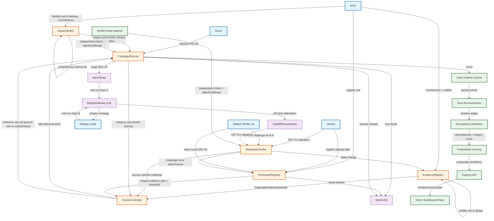

# Phase 0 — Design: Contract Interaction Diagram

## 3. Contract Responsibility Table

| Contract | Responsibility | Key external functions | Key events | Key custom errors |
|---|---|---|---|---|
| ParticipantRegistry | Roles + staked verifier bonds | `registerNGO`, `registerVendor`, `registerVerifier`, `stakeBond`, `slashBond` | `RoleGranted`, `RoleRevoked`, `BondStaked`, `BondSlashed` | `NotAuthorized`, `InsufficientBond`, `AlreadyRegistered` |
| CampaignEscrow | Purpose-bound escrow, tranche release, refunds | `deposit`, `createCampaign`, `requestTrancheRelease`, `refundDonor` | `DepositReceived`, `CampaignCreated`, `TrancheReleased`, `CampaignFrozen`, `Refunded` | `CampaignFrozen`, `InsufficientFunds`, `TrancheNotReady` |
| EvidenceRegistry | Commitments + global nullifier dedup | `submitEvidence`, `revealEvidence` | `EvidenceSubmitted`, `DuplicateEvidenceDetected` | `DuplicateNullifier`, `InvalidCommitment` |
| AttestationVerifier | Vendor EIP-712 attestations + verifier quorum | `vendorAttest`, `verifierAttest`, `verifierChallenge` | `VendorAttested`, `QuorumVerified`, `ChallengeRaised`, `ChallengeResolved` | `InvalidSignature`, `QuorumNotReached`, `AlreadyChallenged` |
| FreezeController | Auto-freeze, no admin switch | `triggerFreeze`, `voteUnfreeze`, `isFrozen` | `CampaignFrozen`, `CampaignUnfrozen` | `NotFrozen`, `AlreadyFrozen`, `InsufficientVotes` |
| ImpactVerifier | Merkle root of delivery commitments, selective disclosure | `publishDeliveryRoot`, `verifyDelivery` | `DeliveryRootPublished`, `DeliveryVerified` | `InvalidProof`, `RootNotFound` |
| MockUSD | Mock stable ERC-20 | `mint`, `transfer`, `approve` | `Transfer`, `Approval` | (ERC-20 standard) |
| MockSwap | Mock ERC-20↔ERC-20 swap | `swap` | `SwapExecuted` | `InsufficientLiquidity` |
| BridgeGateway | Lock/mint bridge pair on two chains | `lock`, `mint`, `relayMessage` | `AssetLocked`, `AssetMinted`, `MessageRelayed` | `NotLocked`, `InvalidMessage` |
| FiatOffRampAttestor | Mock fiat settlement attestation | `attestFiatSettlement` | `FiatSettlementAttested` | `NotAuthorizedPartner` |

## 4. Access Control

- `ParticipantRegistry` uses OpenZeppelin `AccessControl` with roles: `NGO_ROLE`, `VENDOR_ROLE`, `VERIFIER_ROLE`, `DONOR_ROLE`
- Verifiers must stake an ERC-20 bond (`MockUSD`) to be active; stake is slashable on failed challenge
- Vendors register a signing address used for EIP-712 signature verification
- No single EOA can freeze or unfreeze; unfreeze requires verifier-quorum vote or expiry/refund path
- `ReentrancyGuard` on all state-changing external functions; checks-effects-interactions pattern throughout
- `SafeERC20` for all ERC-20 interactions
- `tx.origin` never used; `block.timestamp` never used for randomness